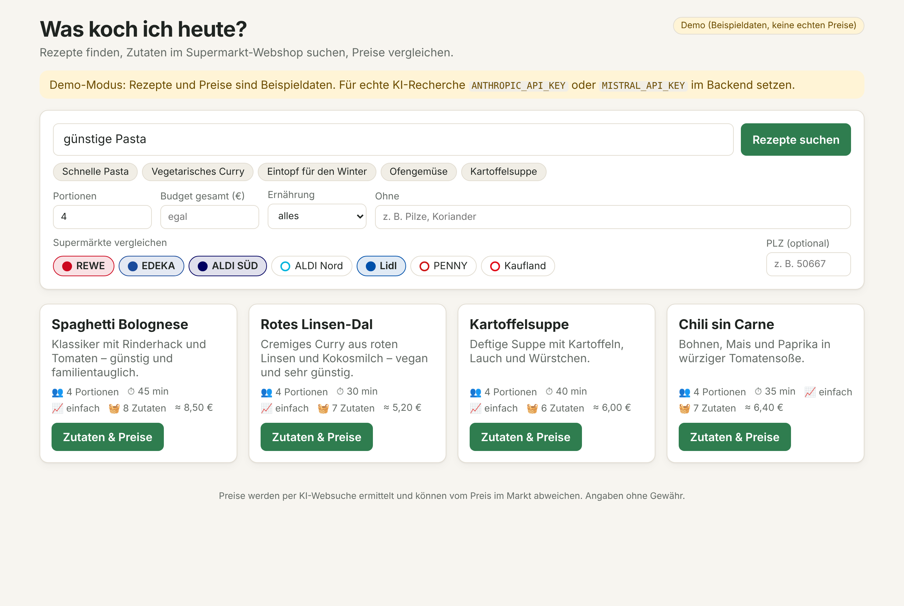
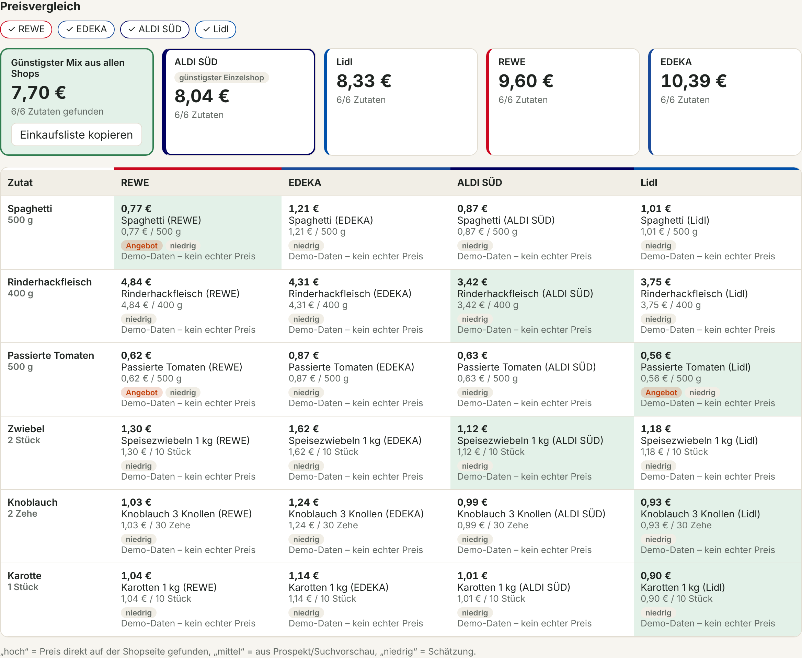
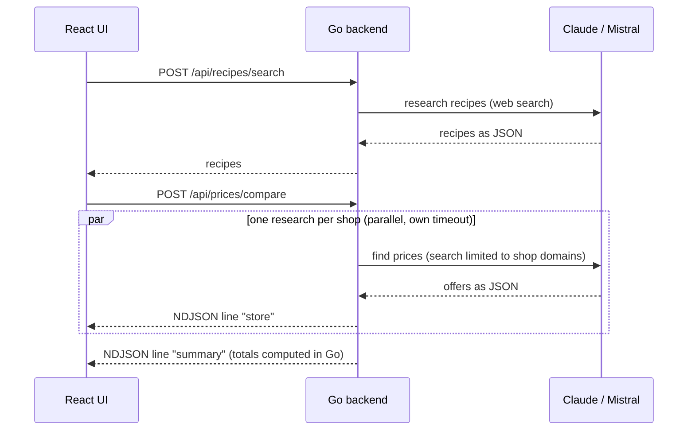

# Was koch ich heute? 🍲

[](https://github.com/Raigen/was-koch-ich-heute/actions/workflows/ci.yml)

*"What should I cook today?"*: a web app for budget-friendly cooking. An AI researches recipes on the
web, looks up every ingredient in the online shops and offers of German supermarkets (REWE, EDEKA,
ALDI SÜD/Nord, Lidl, PENNY, Kaufland) and compares the prices per shop and as the cheapest basket
across all shops.

- **Frontend:** React 19 + TypeScript, built with Vite (`frontend/`)
- **Backend:** Go, standard library plus the Anthropic Go SDK (`backend/`)
- **AI:** pluggable behind one interface. Built in:
  - **Claude** (Anthropic) with server-side web search and fetch (`web_search` / `web_fetch`),
  - **Mistral** via the Conversations API with its built-in `web_search` tool,
  - a **demo mode** with sample data when no API key is set.

The user interface is German because the app targets German supermarkets.

| Recipe search | Price comparison |
|---|---|
|  |  |

*Screenshots from demo mode: the sample prices are not real.*

## Quick start

### With Docker (no Go or Node needed)

```bash
cp .env.example .env   # add an API key; without a key the app runs in demo mode
docker compose up -d --build
```

Then open <http://localhost:8080>. Without Compose:

```bash
docker build --network host -t was-koch-ich-heute .
docker run -d -p 8080:8080 --env-file .env --name was-koch-ich-heute was-koch-ich-heute
```

The image is built in three stages (Node builds the frontend, Go builds the backend). The final image
only contains the static Go binary and the frontend files on `distroless` (about 25 MB, runs as a
non-root user).

The build uses the host network (`--network host`, or `network: host` in the Compose file). On
Windows/WSL, `npm ci` and `go mod download` otherwise often hang for minutes in Docker's bridge network.

### Local development

Requirements: Go ≥ 1.25, Node.js ≥ 20.

```bash
cp .env.example .env              # optional
export ANTHROPIC_API_KEY=sk-ant-… # or: export MISTRAL_API_KEY=…  (no key: demo mode)
make dev
```

Then open <http://localhost:5173>. Vite proxies `/api` to the Go backend on port 8080.

Production build (a single binary that also serves the frontend):

```bash
make build
STATIC_DIR=frontend/dist ./bin/server
```

Tests:

```bash
make test   # go vet + go test, frontend type check
```

GitHub Actions (`.github/workflows/ci.yml`) runs on every push to `main` and every pull request:
- gofmt, `go vet` and `go test -race`,
- the frontend type check and build,
- a Docker image build plus a smoke test of the container in demo mode.

## How it works



1. **Recipe search** (`POST /api/recipes/search`): the AI searches German recipe sites, scales the
   quantities to the requested servings and marks staples (salt, oil …).
2. **Choose ingredients:** everything already at home is unchecked.
3. **Price comparison** (`POST /api/prices/compare`):
   - Every shop is researched in parallel. With Claude, the web search is restricted to the shop's domains.
   - The response is streamed as NDJSON, so each shop's result appears as soon as it is ready.
   - Package counts, costs and totals are computed by the Go backend (`internal/pricing`), never by the AI.

Results are cached in memory (recipes 24 h, prices 6 h) to save API costs.

### API usage and cost

Every recipe search and price comparison shows the AI usage it caused, e.g.
"≈ 0,12 € · 18.400 Tokens · 6 Web-Suchen"; a click on it shows the details (API calls, input, output and
cache tokens, web searches and fetches). The price comparison shows the cost per shop and in total.

- The providers report the usage; the backend sums it over all API calls of a research, including
  resumed `pause_turn` responses, and computes the cost (`internal/pricing/cost.go`). Tokens are priced
  per model call, so a refusal fallback to another model and per-request prices (Claude Haiku 5.5
  above 100,000 prompt tokens) are taken into account.
- `/api/recipes/search` returns `usage` (also with an error, because a failed research can be billed),
  `store` events in `/api/prices/compare` carry the shop's `usage`, and the `summary` event's
  `comparison.usage` holds the total.
- Cache hits cost nothing and are marked `"cached": true`; demo mode reports zero usage.
- A research cut off by a timeout cannot report the usage of its last request: its cost is marked
  `"incomplete": true` (shown as "mind. …"), or unknown (`"costKnown": false`, "Kosten unbekannt") if no
  response arrived at all. The total is then incomplete as well. The same applies to automatic retries:
  if an attempt failed with a timeout, connection error, 408 or 5xx, the usage is marked incomplete even
  when a retry succeeded. A request the API rejected before any work (HTTP 4xx such as an invalid key or
  a rate limit, except 408, with no possibly billed attempt before it) costs a known 0 €.
- The cost is an estimate from a price table (USD list prices, converted to euros). The built-in table
  covers the default models; `PRICE_TABLE` overrides or extends it without code changes:

  ```json
  {
    "eurPerUsd": 0.86,
    "models": {
      "claude-opus-5-5": { "input": 4, "output": 20, "cacheRead": 0.2, "cacheWrite": 5, "webSearchPer1000": 10 }
    }
  }
  ```

  Token prices are per million tokens, tool prices per 1,000 calls. Optional prompt-length pricing:
  `"longContext": {"abovePromptTokens": 100000, "input": 0.5, "output": 2.5, "cacheRead": 0.05, "cacheWrite": 0.625}`.
  A model ID also matches its dated snapshots (`claude-opus-5-5-20261101`, `…@20261101`), but not other
  versions; models without a price show "Kosten unbekannt". Unknown keys and negative prices are
  rejected at startup.

### Design decisions

- **The AI delivers raw data, Go does the math.** Prices and package sizes come from the model; package
  counts, unit conversion and totals are deterministic and unit-tested.
- **Streaming instead of waiting.** Researching one shop takes one to three minutes. NDJSON streaming shows
  results progressively. Each shop has its own timeout, so one slow shop cannot block the others, and
  keep-alive pings stop reverse proxies from closing idle connections.
- **Provider-agnostic.** Prompts and parsers are shared (`prompts.go`); a new provider only implements
  the `Researcher` interface. Mistral shows how to integrate a provider without a Go SDK via plain REST.
- **Honest data.** Every offer has a confidence level, and links outside the shop's domains are dropped.
  Failed or timed-out shops are shown as such and can be retried individually.
- **Tests never call real APIs.** Claude and Mistral are tested against fake HTTP servers (`httptest`).

## Project structure

```
backend/
  cmd/server/            entry point, configuration via environment variables
  internal/api/          HTTP routes, NDJSON streaming, cache, serving the frontend
  internal/research/     Researcher interface; Claude, Mistral and demo implementations;
                         shared prompts; list of shops
  internal/pricing/      units, package counts, price comparison, AI cost estimate
  internal/model/        shared data types (mirrored in frontend/src/types.ts)
frontend/
  src/api.ts             API client including the NDJSON stream reader
  src/components/        search, shop picker, recipe list, detail view, price comparison
```

## Adding an AI provider

`backend/internal/research/research.go` defines:

```go
type Researcher interface {
    Name() string
    SearchRecipes(ctx, model.RecipeQuery) ([]model.Recipe, model.Usage, error)
    FindPrices(ctx, model.Store, []model.Ingredient, postalCode string) (model.StorePrices, model.Usage, error)
}
```

Both methods return the AI usage summed over all API calls, also together with an error.

To add a provider:
1. Write a new implementation of this interface.
2. Register it in `research.New`.
3. Select it with `AI_PROVIDER=<name>`.

## Configuration

| Variable | Meaning | Default |
|---|---|---|
| `AI_PROVIDER` | `claude`, `mistral` or `demo` | first provider with a key (Claude, then Mistral), otherwise `demo` |
| `ANTHROPIC_API_KEY` | API key for Claude | – |
| `CLAUDE_MODEL` | model ID | `claude-opus-5-5` |
| `CLAUDE_EFFORT` | `low` … `max`; lower effort is faster and cheaper | `medium` |
| `MISTRAL_API_KEY` | API key for Mistral | – |
| `MISTRAL_MODEL` | Mistral model | `mistral-medium-latest` |
| `MISTRAL_BASE_URL` | API endpoint, e.g. `https://api.eu.mistral.ai` | `https://api.mistral.ai` |
| `MISTRAL_REASONING_EFFORT` | optional, reasoning models only | – |
| `MISTRAL_WEB_SEARCH` | `standard` or `premium` | `standard` |
| `PRICE_PARALLEL` | concurrent shop research | `4` |
| `STORE_TIMEOUT` | maximum research time per shop, e.g. `3m`, `90s` | `3m` |
| `PRICE_TABLE` | price table for the cost estimate: path to a JSON file or inline JSON (see [API usage and cost](#api-usage-and-cost)) | built-in prices |
| `ADDR` | listen address | `:8080` |
| `STATIC_DIR` | path to the built frontend | – |

## Running behind a reverse proxy

The price comparison streams results over several minutes. Every 15 seconds the backend sends a
keep-alive line (`{"type":"ping"}`) so proxies do not close the connection as idle. It also sets
`X-Accel-Buffering: no` against buffering in nginx. The overall timeout still has to fit:

```nginx
location / {
    proxy_pass http://127.0.0.1:8080;
    proxy_buffering off;
    proxy_read_timeout 600s;
}
```

Caddy (`reverse_proxy 127.0.0.1:8080`) works without extra settings.

Shops that exceed `STORE_TIMEOUT` or fail are marked individually. "Fehlgeschlagene erneut versuchen"
(retry failed) researches only those again; the others come from the cache.

## Limitations

- Many supermarket shops load prices via JavaScript or only show them after a store is selected, so the
  AI does not always find a price. Every offer therefore carries a confidence level:
  - `hoch`: taken directly from the shop page,
  - `mittel`: from a flyer or search preview,
  - `niedrig`: an estimate.
- EDEKA and ALDI have no nationwide delivery shop; their prices mostly come from the online assortment
  and flyers.
- Unlike Claude's, Mistral's web search cannot be restricted to the shop domains. The prompt steers the
  model there instead; the backend drops product links to other sites and lowers their confidence.
- A price comparison costs several web searches per shop. `CLAUDE_EFFORT=low` and fewer shops reduce
  cost and duration.

## Roadmap

See the [issues](https://github.com/Raigen/was-koch-ich-heute/issues):
- API usage and cost per search
- favorites list
- Mealie integration
- Open Prices as a price source
